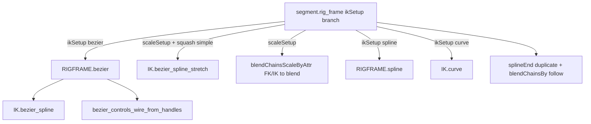

# Branch: Bezier IK (MRS)

## Quick Info

**Status**: Active  
**Created**: October 12, 2026  
**Last Updated**: October 19, 2026 (`squashInflateControl`, stretch DAG under rigNull, Segment twist WU end default)  
**PR**: Pending

## Goals

MRS **IK-only** work: Bezier driver curves plus joint-chain solve on Segment (and later other blocks). Lib prototypes in [`ik_utils.py`](../../cgmToolsPy3/cgm/core/rig/ik_utils.py); **Segment `ikSetup=bezier`** wired via [`rigFrame_utils.bezier`](../../cgmToolsPy3/cgm/core/mrs/lib/rigFrame_utils.py).

**Out of scope for this branch**: prerig mesh, proxy loft, `block_utils` `polyType`, puppet mesh — unless IK work later requires a render mesh (not planned now).

## Tabled — come back later

**Sine on driver** (`spline_ik_curve_add_sine`, `spline_ik_sine_handle_fit_to_curve`, `waveAmplitude` / `waveLength` / `waveOffset` on sine output). Prototype in `ik_utils.py`; not the active artist path.

**Wave / blendShape stack** (`spline_ik_curve_add_wave_blend`, three-curve layout, `waveAmount`, root CV fade). Depends on sine; also tabled.

**Open when resuming sine / wave:**

- Sine handle fit in curve object space vs curve drifting off joints
- Spatial alignment for local blendShape (driver / sine target / wave output)
- Whether IK + exact stretch should use `ikDriver`, sine output, or `waveOutput`
- Animator attrs: `wave` on Bezier vs `waveAmount` vs sine amps only

**Active path for now:** `bezier_spline` → `bezier_controls_add` → optional `bezier_spline_stretch` with `driver_curve=_res['mDriverCurve']` (hidden POCI driver; IK stays on driver until sine stack returns).

**MRS phase (current):** Segment **`ikSetup=bezier`** + **`segmentType=parent`** — shipped / Maya-verified (stretch, squash, scale blend; **arcLength** / **pointDist**; **`ikSplineTwistUpStart`** / **`ikSplineTwistUpEnd`** on block — Segment end default **y+**, Head end **z-**). **Head `neckIK=bezier`** — split **`headIK`** / neck-end **`controlIK`**, advanced spline twist WU, **`ikMidAimSetup`** + **`linearTrack`** root→end mid driver orient (Head-only attr). **Limb `segmentType=bezier`** — per-roll stretch + inflate; twist WU via section mains (no **`ikSplineTwistUp*`** attrs yet). **Inflate** gated by block **`squashInflateControl`** (independent of **`squashExtraControl`**); stretch inflate DAG parented under rigNull via **`parentGutsTo`**. **Next:** non-parent **segment** `segmentType=bezier`, limb polish, Segment **`ikMidAimSetup`** (if desired), sine/wave (tabled).

## Related Documentation

- **[Feature_BezierIK.md](../Features/Feature_BezierIK.md)** — design contract (toggles, build flow, rigNull messages)
- **[Feature_MRSWiring.md](../Features/Feature_MRSWiring.md)** — module/rigNull messages, `ribbonIKDrivers`, control caches when new IK drivers appear
- **[ik_utils.py](../../cgmToolsPy3/cgm/core/rig/ik_utils.py)** — canonical `spline`, `curve`, `bezier_spline`
- **[bezier_utils.py](../../cgmToolsPy3/cgm/core/rig/bezier_utils.py)** — Bezier CV control rigs (`bezier_controls_add`)
- **[rigFrame_utils.py](../../cgmToolsPy3/cgm/core/mrs/lib/rigFrame_utils.py)** — MRS orchestration (`RIGFRAME.spline`, segment mid IK, etc.)
- **[bezier_ik_block_utils.py](../../cgmToolsPy3/cgm/core/mrs/lib/bezier_ik_block_utils.py)** — shared MRS bezier shapes, pickwalk, stretch aim, squash `segmentScaleCompensate`, **`block_squash_inflate_control`**
- **[segment.py](../../cgmToolsPy3/cgm/core/mrs/blocks/organic/segment.py)** — `rig_frame` `ikSetup` branches (`spline`, `curve`, ribbon, rp, …); `rig_prechecks` (bezier + parent `segmentType`, …); bezier stretch + inflate kwargs
- **[head.py](../../cgmToolsPy3/cgm/core/mrs/blocks/organic/head.py)** — neck `neckIK=bezier` (parent segment type); mirrors Segment bezier `rig_shapes` / `rig_frame` / `rig_controls`
- **[limb.py](../../cgmToolsPy3/cgm/core/mrs/blocks/organic/limb.py)** — `segmentType=bezier` roll sections, `_limb_bezier_inflate_slide_global_spec`, `bezier_spline_stretch` per section
- **[Builder.py](../../cgmToolsPy3/cgm/core/mrs/Builder.py)** — `ui_stepBuild` runs `asRigFactory(mode='prechecks')` before stepped rig layout
- **[shared_dat.py](../../cgmToolsPy3/cgm/core/mrs/lib/shared_dat.py)** — `ikSetup` enum vocabulary; **`squashInflateControl`** attr; **`squash_stretch_ik_share_kwargs`** (ribbon/curve IK share dict — strips bezier-only inflate keys)
- **[NewBranch_Guide.md](../Guides/NewBranch_Guide.md)** — timeline and PR maintenance
- **[NewFeature_Guide.md](../Guides/NewFeature_Guide.md)** — feature contract in **`Feature_BezierIK.md`**

## Integration decision

| Choice | Status |
|--------|--------|
| **`ik_utils` first** (`bezier_spline`, `bezier_spline_stretch`) | Done |
| **New `ikSetup` value `bezier`** on Segment | Done (parent `segmentType` only in precheck) |
| **`rigFrame_utils.bezier`** orchestration | Done |
| **Extend `spline` path** instead of separate enum | Rejected for CV Bezier rig clarity |

**Not yet**: limb bezier **full** build sign-off (shapes/controls); Head neck bezier **puppet / mirror** regression; **Segment** `segmentType` **bezier** (non-parent); sine/wave on driver.

### MRS build matrix (target vs status)

| `ikSetup` | `segmentType` | `scaleSetup` + squash **simple** | Status |
|-----------|---------------|----------------------------------|--------|
| **bezier** | **parent** | off | **Shipped** — IK, CV main/sub, end follow, twist |
| **bezier** | **parent** | on (`segmentStretchBy` translate / scale) | **Maya-verified** — `bezier_spline_stretch`, FKIK scale blend |
| **bezier** | **bezier** | off | **Not started** — ribbon-style segment + Bezier driver TBD |
| **bezier** | **bezier** | on | **Not started** — same stretch model as parent after segment path exists |

Native Maya (no MRS): [`Feature_BezierIK.md`](../Features/Feature_BezierIK.md) § Lib API — `bezier_spline` + optional `bezier_spline_stretch` on hidden driver; sine/wave **tabled**.

## Current MRS IK Map

Reference for prototype alignment (segment module; other blocks may call `IK.*` directly).



### Primary call sites

- **`rigFrame_utils.bezier`**: `IK.bezier_spline` on `ml_ikUse`, `masterScale` on driver, twist to controls/settings; links **`bezierIKDriverCurve`** on rigNull.
- **`segment.py` `rig_frame` (`ikSetup == 'bezier'`)**: `RIGFRAME.bezier` → end duplicate + `followIK` orient blend → optional **`bezier_spline_stretch`**; FKIK blend with **`blendChainsScaleByAttr`** when `scaleSetup`.
- **`segment.py` `rig_skeleton`**: `_squash_ik_fk_blend_segment_scale_compensate` when squash + IK.
- **`rigFrame_utils.spline`** / **`IK.curve`**: unchanged legacy paths (see prior branch entries).

## Prototype → Production Alignment Checklist

Use when reviewing pasted prototype chunks (timeline entries below). Target production home: **`cgm/core/rig/ik_utils.py`** or thin **`rigFrame_utils`** orchestrator — not large new logic in block bodies.

| Pattern | Canonical location | Prototypes should match |
|---------|-------------------|-------------------------|
| Joint list boundary | `cgmMeta.validateObjListArg(..., mayaType=['joint'])` in `spline` / `curve` | `ml_*` meta in rig logic; `.mNode` only at `mc.*` |
| Return shape | `IK.spline` → **dict**: `mIKHandle`, `mIKEffector`, `mIKSolver`, `mSplineCurve`, twist plugs | Prefer dict returns for new helpers |
| Driver curve tagging | `cgmType='splineIKCurve'`, `doName()`, segment group / owner links | Same vocabulary if reusing spline twist/stretch |
| IK handle messaging | `mSegmentCurve.msgList_append('ikHandles', …)`; `mIKHandle.msgList_connect('drivenJoints', …)` | No parallel string registries |
| Module hook | `moduleInstance` → rigNull parent, guts vis/lock | Pass `mModule` when building inside MRS |
| Stretch | `spline`: POCI + stretch on curve; `curve`: squash/stretch surface | Document which model Bezier IK uses |
| Twist | `IKHandle_addSplineIKTwist` + MRS control wiring | If not `ikSplineSolver`, document alternate twist |
| MRS drivers | `mRigNull.msgList_get('ribbonIKDrivers')` as skin influences | Bezier CV controls → here or new msgList (grep before inventing) |
| End behavior | spline end duplicate + `RIGCONSTRAINT.blendChainsBy` | Decide reuse vs simplify for Bezier |
| Placement | `ik_utils` / `rigFrame_utils` | See `cgm-module-placement` rule |

### Code review workflow

For each prototype batch (chat or file path):

1. **What** — behavior summary in Maya.
2. **Alignment notes** — bullets mapped to checklist above (improvements; no py3 merge unless requested).
3. **Decisions** — solver, curve type (Bezier NURBS vs CV rig), stretch/twist ownership.
4. **Files** — NEW/EXTENDED once code lands in py3.

---

## Timeline

### October 19, 2026 - `squashInflateControl`, IK share filter, stretch DAG parenting

**What**:

- **Block `squashInflateControl`** (Segment, Head, Limb; default **on**): drives **`bezier_spline_stretch`** **`extraInflateControl`** only (`squashInflate`, `squashInflateOffset`, `{part}_inflateFactor_i` ramp). **`squashExtraControl`** still owns volume **`outFactor`** only. Legacy blocks without the attr fall back to **`squashExtraControl`** via **`bezier_ik_block_utils.block_squash_inflate_control`**.
- **Do not put inflate flags on `d_squashStretch` for ribbon/curve:** **`shared_dat.squash_stretch_ik_share_kwargs`** filters **`extraInflateControl`** + **`inflateFactor*`** before **`_d_ribbonShare.update`** — fixes **`IK.curve()`** / **`IK.ribbon()`** `TypeError` on limb roll **`segmentType=curve`** builds.
- **Twist WU default (Segment):** **`ikSplineTwistUpEnd`** default **y+** (Head unchanged **z-**).
- **Stretch DAG under rigNull:** **`bezier_spline_stretch(parentGutsTo=mRigNull)`** creates **`{baseName}_bezierStretch_grp`** on rigNull and parents transform DAG (e.g. **`{base}_inflateSample_##_floorUtil`**) so rig cleanUp does not delete inflate sampling utils.

**Files**:

- EXTENDED: `cgm/core/rig/ik_utils.py` — `parentGutsTo`, `_bezier_stretch_guts_group`, `_bezier_stretch_parent_dag_under`
- EXTENDED: `cgm/core/mrs/lib/shared_dat.py`, `bezier_ik_block_utils.py`
- EXTENDED: `cgm/core/mrs/blocks/organic/segment.py`, `head.py`, `limb.py` — attr, callers, ribbon share filter
- EXTENDED: `cgm/core/mrs/lib/block_utils.py` — limb squash UI lists
- EXTENDED: `Features/Feature_BezierIK.md`, `Branches/Branch_BezierIK.md`

**Status**: In py3 — reload **`ik_utils`**, block modules, **`shared_dat`** before limb **rig_segments** / bezier stretch rebuild.

---

### October 15, 2026 - Twist WU attrs, advanced twist, inflate contract, Head mid aim

**What**:

- **Spline bezier twist (Segment + Head):** Block attrs **`ikSplineTwistUpStart`** / **`ikSplineTwistUpEnd`** (`shapeDirection` enum; start **y+**; end **y+** on Segment, **z-** on Head — Oct 19 Segment default). **`bezier_ik_connect_spline_advanced_twist`** in **`bezier_ik_block_utils.py`** → **`RIGDYN._apply_hair_spline_ik_advanced_twist`** (`dWorldUpType` Object Rotation Up Start/End, fwd/up axes from orientation, WU matrices from base/end IK). Driver **`twistStart`/`twistEnd`** still from **`RIGFRAME.bezier`** + **`ikSplineTwistEndConnect`** (Head: **`twistEndAdd`** on **`headIK`** when split). **No** **`IK.handle_fixTwist`** on ikSpline bezier handles.
- **Inflate:** **`inflateFactor_*`** attrs no longer clamped to ≥ 0; negative block **`inflateFactorMin`** + ramp modes allow **contract** on some joints while **`squashInflate` > 0** (`volScale + factorSample × squashInflate`).
- **Head mid IK (Head-only):** Block **`ikMidAimSetup`** (default off). **`ikMidSetup=linearTrack`** + aim on: **`{part}_midRootEnd_aimRef`** under **`controlIKBase`**, **`aimConstraint`** to end IK; **`orientConstraint`** ref → each mid **`mainDriver`** (track attach target). Replaces driver-to-driver aim for that path. Segment has no **`ikMidAimSetup`** attr (legacy driver-chain aim when mid track aim runs).

**Files**:

- EXTENDED: `cgm/core/mrs/lib/bezier_ik_block_utils.py` — `bezier_ik_connect_spline_advanced_twist`, `bezier_ik_block_twist_world_up_vectors`
- EXTENDED: `cgm/core/mrs/lib/rigFrame_utils.py` — `bezier` calls advanced twist; `segment_mid` Head linearTrack root→end aim
- EXTENDED: `cgm/core/rig/dynamic_utils.py` — optional `v_worldUpStart` / `v_worldUpEnd` on `_apply_hair_spline_ik_advanced_twist`
- EXTENDED: `cgm/core/rig/ik_utils.py` — negative inflate factor plugs
- EXTENDED: `cgm/core/mrs/blocks/organic/segment.py`, `head.py` — `ikSplineTwistUp*` attrs; Head `ikMidAimSetup` (existing)
- EXTENDED: `cgm/core/mrs/blocks/organic/limb.py` — limb section twist delegates to shared helper
- EXTENDED: `Features/Feature_BezierIK.md`, `Branches/Branch_BezierIK.md`

**Status**: In py3 — Head neck bezier + mid linearTrack aim user-verified; Segment twist attrs on block; reload **`rigFrame_utils`**, **`bezier_ik_block_utils`**, **`ik_utils`**, block module before rig frame rebuild.

---

### October 15, 2026 - Head bezier pickwalk + controller_getDat

**What**:

- **`rig_skeleton`**: **`msgList_connect('controlSegMidIK', ml_ikMidControls)`** (Segment parity — required for **`bezier_ik_pickwalk_controls`**).
- **`rig_controls`**: neck bezier path registers end **`controlIK`** + reconnects **`controlIK`/`controlIKBase`**; subs + **`bezier_ik_pickwalk_controls`** → **`controlsIK`**; **`controlIKNeckRoot`** prepended when present; **`headIK`** excluded from pickwalk (still **`controlsAll`** + **`controller_getDat`**).
- **`d_controlDat_links`** + **`controller_getDat`** bezier branch (match Segment dedupe + ordered pickwalk + **`headIK`**).

**Files**: EXTENDED `head.py`; EXTENDED `Feature_BezierIK.md`, `Branches/Branch_BezierIK.md`

**Status**: Rebuild **rig controls** + puppet **controller_verify** after reload **`head`**.

---

### October 19, 2026 - Head neck bezier head IK joint (Maya-verified)

**What**:

- **Head** **`neckIK=bezier`**, **`neckControls > 1`**: **`ml_ikJoints[-1]`** (`head_*_ik_sknJnt`) is a **clean** child of **`headIK`** — no **`pointConstraint`**, **`followIK`**, or **`_splineControl`** on that joint (differs from **Segment** end follow). Neck solve uses **`ml_ikUse`** with **`_splineEnd`** parented under **`ml_ikJoints[-2]`**; ribbon end stays on neck-end **`controlIK`**. **`mTwistEndControl=headIK`**. **`scaleSetup`**: no redundant **`scaleConstraint(headIK → last ik)`** when split.

**Files**: EXTENDED `head.py`; EXTENDED `Features/Feature_BezierIK.md`, `Branches/Branch_BezierIK.md`

**Status**: Maya-verified on user template.

---

### October 15, 2026 - pointDist masterScale + Head control split

**What**:

- **`IK.bezier_spline_stretch`** **`squashMeasure=pointDist`**: `_bezier_stretch_seg_final_ratio_network` no longer divides bind rest distance by `masterScale` (was canceling scale compensation and doubling volume squash under global scale). Now **`segRatio = (distance / masterScale) / bindSegDist`** — same contract as arcLength (normalize live measure only) and legacy ribbon pointDist (`distance / (aimBase * masterScale)`).
- **Head** **`neckIK=bezier`**: **`headIK`** remains the main head anim control; **`controlIK`** is a separate neck-end **ikBezier** handle (`rig_shapes` from end **`ribbonIKDriver`**). **`rig_controls`**: register end **`controlIK`** before bezier subs/pickwalk; **`headIK`** not duplicated in primary **`controlsIK`** pickwalk. **`rig_frame`**: ribbon end on neck-end **`controlIK`**; head IK joint under **`headIK`**; stretch on **`ml_ikUse`** through neck + spline end (see Oct 19 for constraint-free head joint). **`int_handleEndIdx = -2`** for end-cube FK sizing.

**Files**:

- EXTENDED: `cgm/core/rig/ik_utils.py` — pointDist per-segment ratio + inflate floor util cleanup (prior)
- EXTENDED: `cgm/core/mrs/blocks/organic/head.py` — shapes, controls, frame for split controls
- EXTENDED: `Features/Feature_BezierIK.md`, `Branches/Branch_BezierIK.md`

**Status**: **Maya-verified** — pointDist squash/stretch under puppet scale; Head neck bezier + head anim control on user template.

---

### October 14, 2026 - Head neck bezier + shared block utils

**What**: **Head** block **`neckIK=bezier`** with **`segmentType=parent`** (phase 1): CV mains/subs, `RIGFRAME.bezier`, `bezier_spline_stretch` + inflate attrs, FK/IK scale via **`blendChainsScaleByAttr`**. Extracted Segment bezier helpers to **`bezier_ik_block_utils.py`** (Segment, Head, Limb import).

**Files**:

- NEW: `cgm/core/mrs/lib/bezier_ik_block_utils.py`
- EXTENDED: `cgm/core/mrs/blocks/organic/head.py` — prechecks, attrs, `rig_dataBuffer`, `rig_shapes`, `rig_controls`, `rig_frame`, `rig_skeleton`
- EXTENDED: `cgm/core/mrs/blocks/organic/segment.py` — call shared utils (removed duplicated helpers)
- EXTENDED: `cgm/core/mrs/blocks/organic/limb.py` — import shared utils for squash / bezier shape helpers
- EXTENDED: `Features/Feature_BezierIK.md`, `Branches/Branch_BezierIK.md`

**Status**: Code complete — **Maya sign-off pending** (Head neck bezier + Segment regression after utils extract).

---

### October 12, 2026 - Branch doc and IK map

**What**: Opened Bezier IK branch tracking; documented MRS `ikSetup` paths, `ik_utils` alignment checklist, and open integration options. IK-only scope (no mesh/proxy).

**Files**:

- NEW: `Branches/Branch_BezierIK.md`

**Decisions**:

- Integration path left TBD until prototype chunks are reviewed.
- Feature contract doc (`Feature_BezierIK.md`) deferred until behavior is agreed.

**Status**: Superseded by Phase 1 entry below.

---

### October 12, 2026 - Prototype ported to `ik_utils` (no MRS)

**What**: Script-editor prototype merged into py3 as `IK.bezier_spline` plus `CURVES.sample_polyline_by_parameter`. **No** `rigFrame_utils`, **no** segment block, **no** `ikSetup` enum this pass.

**Files**:

- EXTENDED: `cgm/core/lib/curve_Utils.py` — `sample_polyline_by_parameter`
- EXTENDED: `cgm/core/rig/ik_utils.py` — `bezier_spline`, private Bezier/driver helpers
- NEW: `cgm/core/rig/bezier_utils.py` — `bezier_controls_add` on **`bezierIKCurve`** from `bezier_spline` (not hidden driver)

**Alignment notes**:

- Meta return dict (`mBezierCurve`, `mDriverCurve`, `mIKHandle`, …); `msgList` on driver/handle; `cgmType` `bezierIKCurve` / `splineIKCurve`.
- Twist plugs via existing `IKHandle_addSplineIKTwist` (default `advancedTwistSetup=False`).
- `moduleInstance` / rigNull guts path kept for later MRS — **omit** in native Maya tests.
- Stretch, ribbon drivers, end `blendChainsBy` — **deferred** to MRS orchestration phase.

**Decisions**:

- **Integration option**: `ik_utils` first (confirmed); MRS blocks after Maya sign-off.
- POCI sample uses uniform Bezier U (same as prototype); joint anchors use polyline arc-length.

**Native Maya test** (after Reload Dependencies or `CGM._reload` if needed):

```python
import cgm.core.rig.ik_utils as IK
import cgm.core.rig.bezier_utils as RIGBEZIER

# Select root joint of a non-branching chain, then:
_res = IK.bezier_spline(baseName='testBezier')
mc.select(_res['mBezierCurve'].mNode)
RIGBEZIER.bezier_controls_add()

# Optional exact-length stretch (sine/wave tabled — use hidden driver)
_stretch = IK.bezier_spline_stretch(
    root_joint=_res['ml_joints'][0],
    driver_curve=_res['mDriverCurve'],
    settings_node=_res['mBezierCurve'],
    aim_axis='x',
    name='testBezierStretch')
```

**Status**: Code in py3 — artist Maya verification pending (core path only; sine/wave tabled).

---

### October 12, 2026 - Sine deformer on spline IK driver (prototype chunk)

**What**: Script-editor `add_sine_to_spline_curve` ported as `IK.spline_ik_curve_add_sine`. Duplicates the driver, `create`/`local` feed from source, sine nonLinear on duplicate, animator `waveAmplitude` / `waveLength` / `waveOffset` on output transform, optional rewire of spline `ikHandle.inCurve` to deformed `worldSpace[0]`.

**Files**:

- EXTENDED: `cgm/core/rig/ik_utils.py` — `spline_ik_curve_add_sine`, `_spline_ik_nurbs_curve_xform_and_shape`

**Alignment notes**:

- Meta return dict; `cgmType` `splineIKSineCurve` on output; source stays typed `splineIKCurve` (hidden when `hide_source=True`).
- Works on any NURBS spline driver (Bezier hidden driver or plain `IK.spline` curve).
- No msgList wiring yet — optional later link output curve ↔ `ikHandles` / setup group.
- `bezier_spline_stretch` `driver_curve` must be **deformed** `mOutputCurve` for `curveInfo` when sine is in the chain — not the hidden POCI driver.

**Native Maya test** (after `bezier_spline`):

```python
import cgm.core.rig.ik_utils as IK

_res = IK.bezier_spline(baseName='dynamicChain')
_sine = IK.spline_ik_curve_add_sine(
    source_curve=_res['mDriverCurve'],
    ik_handle=_res['mIKHandle'],
    baseName='dynamicChain',
    amplitude=1.0,
    wavelength=4.0,
    offset=0.0)
IK.bezier_spline_stretch(
    root_joint=_res['ml_joints'][0],
    driver_curve=_sine['mOutputCurve'],
    settings_node=_res['mBezierCurve'],
    aim_axis='x',
    name='dynamicChainExact')
```

**Status**: **TABLED** (see top of doc) — code in py3 for when sine stack resumes.

---

### October 12, 2026 - Sine handle fit to curve span

**What**: `spline_ik_sine_handle_fit_to_curve` — aim handle local Y first CV → last CV, `scaleY` = half straight span, `lowBound`/`highBound` ±1. Called automatically from `spline_ik_curve_add_sine` when `fit_handle=True` (default).

**Files**: EXTENDED `cgm/core/rig/ik_utils.py`

**Re-fit on existing setup**:

```python
IK.spline_ik_sine_handle_fit_to_curve(
    curve=_sine['mSourceCurve'],
    sine_handle=_sine['mSineHandle'],
    sine_deformer=_sine['mSineDeformer'],
    baseName='dynamicChain')
```

**Status**: **TABLED** (with sine).

---

### October 12, 2026 - Wave blend output (local blendShape)

**What**: `spline_ik_curve_add_wave_blend` — final curve with `create` from clean base + local `blendShape` from sine target; root CV pinned, `root_fade_cvs` smoothstep; animator `waveAmount` on output. IK follows `mOutputCurve`.

**Files**: EXTENDED `cgm/core/rig/ik_utils.py`

**Pipeline** (reload `ik_utils`):

```python
_res = IK.bezier_spline(baseName='dynamicChain')
_sine = IK.spline_ik_curve_add_sine(
    source_curve=_res['mDriverCurve'],
    ik_handle=None,
    baseName='dynamicChain')
_wave = IK.spline_ik_curve_add_wave_blend(
    base_curve=_res['mDriverCurve'],
    wave_target_curve=_sine['mOutputCurve'],
    ik_handle=_res['mIKHandle'],
    baseName='dynamicChain')
IK.bezier_spline_stretch(
    root_joint=_res['ml_joints'][0],
    driver_curve=_wave['mOutputCurve'],
    settings_node=_res['mBezierCurve'],
    aim_axis='x',
    name='dynamicChainExact')
```

Sine tuning stays on sine output (`waveAmplitude`, …); blend on final output (`waveAmount`).

**Status**: **TABLED** — do not block Phase 1 sign-off on this path; resume alignment + artist workflow later.

---

### October 14, 2026 - Bezier stretch inflate + limb segment squash-stretch

**What**: Extended **`IK.bezier_spline_stretch`** with optional **inflate** layer on top of volume squash (does not change volume `outFactor` math). Settings: **`squashInflate`**, **`squashInflateOffset`**, per-index **`{part}_inflateFactor_i`** (`inflateFactorMin/Max/Mode` on Segment + Limb blocks). Offset sampling: shift along chain, lerp adjacent factors (ribbon_seal / `split_blends` style). **Limb** bezier roll sections call stretch with global inflate indices across sections. DG: **`_bezier_stretch_dg_named_node`** (`mc.createNode` + `cgmNode` rename); floor index via **`floorUtil`** + expression (avoid `cgmNode(nodeType='floatMath')`). **Oct 19:** block **`squashInflateControl`** toggles inflate layer; **`floorUtil`** transforms parent under **`{base}_bezierStretch_grp`** on rigNull (**`parentGutsTo`**).

**Files**:

- EXTENDED: `cgm/core/rig/ik_utils.py` — inflate factor attrs, offset sample network, `inflateAdd_*`, `extraInflateControl` kwargs
- EXTENDED: `cgm/core/mrs/blocks/organic/segment.py` — `inflateFactor*` block attrs, stretch caller kwargs
- EXTENDED: `cgm/core/mrs/blocks/organic/limb.py` — bezier segment stretch, `_limb_bezier_inflate_slide_global_spec`
- EXTENDED: `Features/Feature_BezierIK.md`, `Branches/Branch_BezierIK.md`

**Artist / TA notes**:

- Inflate strength is **`squashInflate`** (default **0**); factor attrs alone do not bulge until it is raised.
- Rebuild segment/limb **rig_segments** (or full module build) after py3 sync — stale inflate expression/DG from prior builds should be replaced, not patched in place.

**Status**: In py3 — limb bezier segment stretch building; Maya verify inflate + offset on arm template ongoing.

---

### October 13, 2026 - Segment parent bezier + squash/stretch (Maya-verified)

**What**: MRS Segment build for **`ikSetup=bezier`**, **`segmentType=parent`**: CV main/sub controls, `RIGFRAME.bezier`, end follow, **`scaleSetup` + squash `simple`** → `IK.bezier_spline_stretch` with **`segmentStretchBy`** translate and scale. Squash skeleton **`segmentScaleCompensate`** on ik/fk/blend at **`rig_skeleton`**. Scale setup FK/IK → blend uses **`RIGCONSTRAINT.blendChainsScaleByAttr`** (per-axis `blendTwoAttr`) instead of scaleConstraint (fixes doubled / uneven blend scale). Translate-mode volume squash uses linear **1/clamped ratio** (`_bezier_stretch_volume_driver`).

**Files**:

- EXTENDED: `cgm/core/mrs/blocks/organic/segment.py` — bezier `rig_shapes` / `rig_frame` / `rig_skeleton`, stretch gate, scale blend path
- EXTENDED: `cgm/core/mrs/lib/rigFrame_utils.py` — `bezier()`
- EXTENDED: `cgm/core/rig/ik_utils.py` — `bezier_spline_stretch` (`stretchBy`, volume driver)
- EXTENDED: `cgm/core/rig/bezier_utils.py` — CV wire from parallel sub lists
- EXTENDED: `cgm/core/rig/constraint_utils.py` — `blendChainsScaleByAttr`
- NEW: `Features/Feature_BezierIK.md`; updated `Branches/Branch_BezierIK.md`, `AGENTS.md`, `Feature_MRSWiring.md`

**Block toggles**:

- `scaleSetup` + `squash` = **simple** → stretch network
- `segmentStretchBy` = **translate** | **scale**
- Precheck: bezier requires **parent** segment type; `scaleSetup` allowed on bezier (old block removed)

**Maya**: Rebuild segment module after reload `ik_utils` / `constraint_utils` / segment stack. User sign-off: translate + scale parent segment methods working.

**Status**: Active — parent segment bezier stretch + scale blend verified; sine/wave still tabled.

---

### October 13, 2026 - Step Build runs rig prechecks in UI

**What**: MRS **Rig → Step Build** no longer raises `ValueError` from `rigFactory` when block prechecks fail (e.g. `ikSetup=bezier` with `segmentType` ribbon). Matches **Rig → Prechecks** behavior: `asRigFactory(autoBuild=False, mode='prechecks')` first; on failure the stepped window lists numbered errors and omits build-step buttons (Script Editor still gets factory precheck lines).

**Files**:

- EXTENDED: `cgm/core/mrs/Builder.py` — `ui_stepBuild._uiFunc_rigPrechecks`, `_uiFunc_layoutPrecheckFailure`, `build_layoutWrapper` gate

**Artist / TA workflow**:

- Misconfigured bezier segment (wrong `segmentType`, parent control/joint count, skeleton state, …) → open Step Build → read **Precheck errors** panel; fix block attrs → retry.
- **Rig → Prechecks** on selection still valid for batch / script-editor-only pass/fail banners.

**Status**: In py3 — reload `Builder` module or relaunch MRS Builder after sync.

---

### October 13, 2026 - Docs sync (build matrix + cross-refs)

**What**: Documented MRS **build matrix** (parent vs `segmentType` bezier × squash/stretch). Updated goals, PR next steps, [`Feature_BezierIK.md`](../Features/Feature_BezierIK.md) roadmap, [`Feature_MRSWiring.md`](../Features/Feature_MRSWiring.md) rigNull table, [`AGENTS.md`](../AGENTS.md) index.

**Status**: Docs only — no py3 change.

---

## Deliverables

### Phase 0 — Prototype validation

- [x] Prototype reviewed and mapped to `ik_utils`
- [ ] Maya validation on joint chain (native test snippet above)

### Phase 1 — `ik_utils` / `bezier_utils`

- [x] `bezier_spline` + curve sampling helper (`ik_utils`)
- [x] `bezier_controls_add` (`bezier_utils`) + Create menu / toolbox **BzrCtl**
- [x] `bezier_spline_stretch` (`ik_utils`) — `curveInfo`, `stretchBy`, volume driver split translate/scale
- [ ] **TABLED** `spline_ik_curve_add_sine` + `spline_ik_sine_handle_fit_to_curve`
- [ ] **TABLED** `spline_ik_curve_add_wave_blend` — local blendShape stack
- [x] Maya sign-off — parent segment: twist, CV controls, stretch translate/scale, squash, scale blend (**no sine/wave**)

### Phase 2 — `rigFrame_utils`

- [x] `RIGFRAME.bezier` — `bezier_spline`, masterScale, twist, `bezierIKDriverCurve` on rigNull

### Phase 3 — MRS Segment wiring

- [x] `segment` bezier path (`rig_shapes`, `rig_frame`, `rig_controls`, pickwalk)
- [x] `ikSetup` **bezier** in block enum / precheck (parent `segmentType`)
- [x] Step Build surfaces `rig_prechecks` failures in UI (no GuiFactory traceback)
- [x] **Head** `neckIK=bezier` + parent `segmentType` (stretch/squash/inflate + **`headIK`** / **`controlIK`** split — template Maya-verified)
- [x] `bezier_ik_block_utils.py` — shared shapes / pickwalk / squash compensate
- [ ] `segmentType` **bezier** (+ squash/stretch parity with parent)
- [ ] Limb `segmentType=bezier` — [x] `rig_segments` squash/stretch + inflate kwargs; [ ] shapes/controls / puppet regression

### Phase 4 — Design contract

- [x] `Features/Feature_BezierIK.md`
- [x] `AGENTS.md` index line

### Testing

- [x] Segment build smoke — bezier parent + scaleSetup + squash simple
- [x] Stretch translate / scale; FKIK scale blend to blend chain
- [x] **`squashMeasure` pointDist** + **`segMeasure`** master scale — no double global squash (Oct 15)
- [x] Head neck bezier — **`headIK`** anim + neck-end **`controlIK`**; head IK joint clean under **`headIK`** (Oct 19)
- [x] Head **`ikMidAimSetup`** + **`linearTrack`** — root→end **`midRootEnd_aimRef`**, orient on **`mainDriver`** (Oct 15)
- [x] Segment + Head **`ikSplineTwistUpStart`** / **`ikSplineTwistUpEnd`** on bezier build (Oct 15)
- [x] Negative **`inflateFactor_*`** for contract/inflate contrast (Oct 15)
- [x] **`squashInflateControl`** off — no inflate settings attrs / floorUtil DAG; on — inflate layer + rigNull parenting (Oct 19)
- [x] Limb roll **`segmentType=curve`** — no **`extraInflateControl`** leaked into **`IK.curve`** (Oct 19)
- [x] Step Build — intentional precheck fail (bezier + non-parent `segmentType`) shows error list, window stays open
- [ ] Mirror / full puppet regression with bezier subs on rigNull

---

## PR Notes

### TBD

#### Overview

Bezier IK for MRS segments (and related modules): Bezier driver curve + joint solve, integrated via `ik_utils` and `rigFrame_utils` patterns. Block enum and feature doc follow locked integration choice.

#### Major changes

- `cgm/core/rig/ik_utils.py` — `bezier_spline`, `bezier_spline_stretch`
- `cgm/core/rig/bezier_utils.py` — CV control wire
- `cgm/core/rig/constraint_utils.py` — `blendChainsScaleByAttr`
- `cgm/core/mrs/lib/rigFrame_utils.py` — `bezier`
- `cgm/core/mrs/blocks/organic/segment.py` — bezier build + squash/stretch + scale blend
- `cgm/core/mrs/Builder.py` — Step Build precheck gate on `ui_stepBuild`
- `cgm/core/mrs/lib/shared_dat.py` — `ikSetup` includes `bezier`

#### Breaking changes

None expected until block enum changes; document if existing `spline` behavior shifts.

#### Maya test plan

- Segment: `ikSetup=bezier`, `segmentType=parent`, `scaleSetup`, squash `simple`; test `segmentStretchBy` translate and scale.
- FKIK blend: blend joint scale matches IK/FK at extremes; no scaleConstraint doubling.
- Step Build: with `ikSetup=bezier` + `segmentType` ribbon (or other fail), window lists precheck errors; after fix to **parent**, step buttons appear.
- Reload `ik_utils` + `constraint_utils` after lib edits; rebuild module.
- **`squashMeasure` pointDist** on Segment or Head bezier: scale puppet master; segment ratios stay ~1 at rest; volume squash matches arcLength feel.
- Head **`neckIK=bezier`**, **`neckControls > 1`**: **`head_*_ik_anim`** + separate neck-end ikBezier **`controlIK`**; **`head_*_ik_sknJnt`** parented under **`headIK`** only (no spline-end constraints on that joint); neck-end cube space/switch targets **`headIK`**.
- Head **`ikMidSetup=linearTrack`**, **`ikMidAimSetup` on**: mid drivers orient from **`midRootEnd_aimRef`** (child of base IK), not adjacent-driver aims.
- Segment / Head bezier: tweak **`ikSplineTwistUpStart`** / **`ikSplineTwistUpEnd`**, rebuild rig frame; ikHandle **`dWorldUpVector`** / **`dWorldUpVectorEnd`** follow enums.
- Inflate: **`squashInflateControl` on**, **`inflateFactorMin=-1`**, **`midPeak`**, **`squashInflate > 0`** — ends contract, mid inflates; **`head_bezier_inflateSample_*_floorUtil`** under **`head_bezier_bezierStretch_grp`** on rigNull after rebuild.
- Segment bezier: **`ikSplineTwistUpEnd=y+`** default; Head neck bezier end WU still **z-** default.

#### Next steps

1. **`segmentType` bezier** + `ikSetup` bezier (no squash, then with `scaleSetup`).
2. Limb / other blocks (grep `ikSetup` call sites).
3. Resume sine/wave tabled stack; mirror / puppet QC.

---

**Ready for Review** — Segment parent bezier + stretch path ready for PR review; sine/wave out of scope.

---

## Notes

### Patterns to reuse

- `IK.spline` return dict and segment-curve message lists.
- `ribbonIKDrivers` → skin cluster → rebuilt driver curve (`RIGFRAME.spline`).
- Spline end duplicate + `blendChainsBy` for IK follow (`followIK` / `followEnd` plugs).

### Future considerations

- Whether Bezier IK shares `ikSplineTwist*` block attrs with `spline` or needs a dedicated attr set.
- Limb/head blocks that import `IK` — grep before assuming segment-only.

---

*Last Updated: October 19, 2026*  
*Branch Status: Active — Segment + Head parent bezier (twist WU attrs, **`squashInflateControl`**, inflate DAG on rigNull); Head `headIK` vs neck-end `controlIK` + mid linearTrack aim; limb bezier segment stretch + inflate + ribbon/curve IK share filter; sine/wave tabled*
