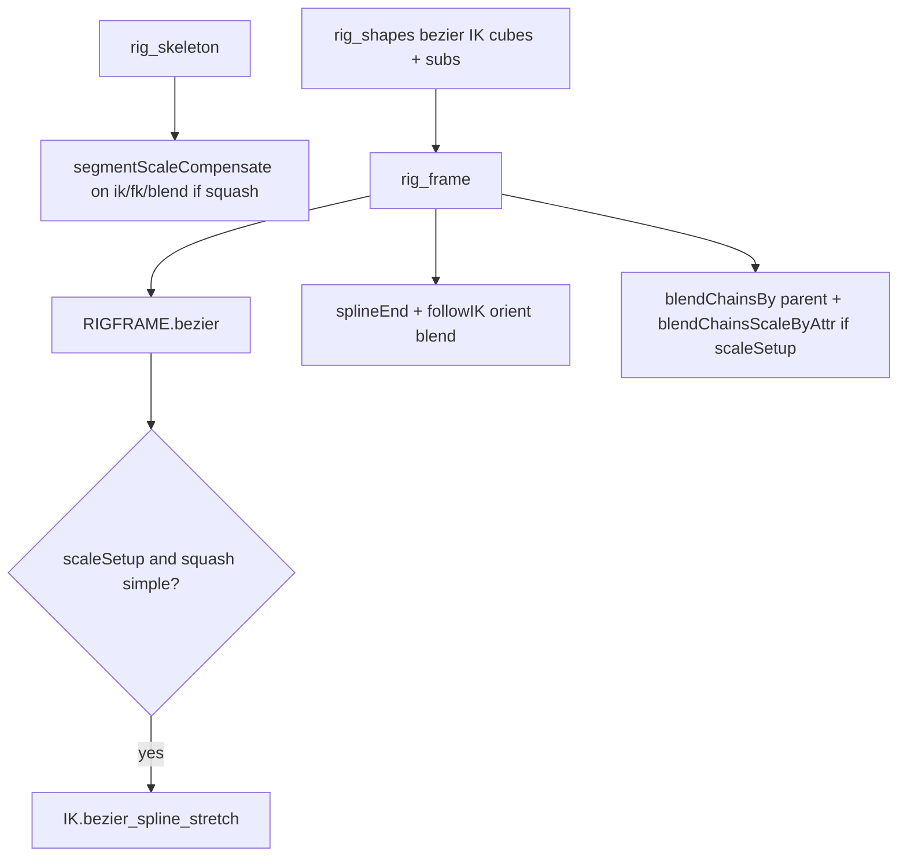

# Feature: Bezier IK (MRS Segment)

## Status and Overview

- **Status**: In progress — **Maya-verified** for Segment `ikSetup=bezier`, `segmentType=parent`, `scaleSetup` + squash **simple**, `segmentStretchBy` **translate** and **scale**
- **Last Updated**: October 14, 2026 (bezier stretch inflate / `squashExtraControl`)
- **Audience**: Dev / TA — design contract for Bezier spline IK on MRS Segment (not artist manual prose)
- **Branch timeline**: [`Branches/Branch_BezierIK.md`](../Branches/Branch_BezierIK.md)

**Maintenance rule**: Update when changing `IK.bezier_spline`, `IK.bezier_spline_stretch`, `bezier_utils`, `rigFrame_utils.bezier`, or Segment / Limb `rig_segments` bezier squash-stretch paths (`segment.py`, `limb.py`).

**Related**

- [`Feature_MRSWiring.md`](Feature_MRSWiring.md) — rigNull messages, control caches
- [`Builder.py`](../../cgmToolsPy3/cgm/core/mrs/Builder.py) — MRS Builder **Step Build** (`ui_stepBuild`)
- [`ik_utils.py`](../../cgmToolsPy3/cgm/core/rig/ik_utils.py), [`bezier_utils.py`](../../cgmToolsPy3/cgm/core/rig/bezier_utils.py), [`rigFrame_utils.py`](../../cgmToolsPy3/cgm/core/mrs/lib/rigFrame_utils.py), [`segment.py`](../../cgmToolsPy3/cgm/core/mrs/blocks/organic/segment.py)

---

## Scope (current)

### In scope (shipped / verified)

| Block config | Behavior |
|--------------|----------|
| `ikSetup` **bezier** | `RIGFRAME.bezier` → `IK.bezier_spline` + CV control wire |
| `segmentType` **parent** | Precheck enforces; ribbon-style segment joints optional per parent path |
| `scaleSetup` on | FK/IK → blend: **parent** `blendChainsBy` + **`blendChainsScaleByAttr`** (not scaleConstraint) |
| `squash` **simple** + `scaleSetup` | `IK.bezier_spline_stretch` on IK chain (`ml_ikUse` with spline end joint) |
| `segmentStretchBy` | **translate** or **scale** — passed to `bezier_spline_stretch` |
| `squashMeasure` | **arcLength** (default, production) — global driver `curveInfo` ratio; **pointDist** — *(experimental)* per-segment `distanceDim` on driver **POCI** positions (bind U; scale stretch). Translate stretch may track joint U via **nearestPointOnCurve** → POCI `parameter` |

### Out of scope (this feature doc)

- Sine / wave driver stack on hidden POCI curve (**tabled** on [`Branch_BezierIK.md`](../Branches/Branch_BezierIK.md))
- `segmentType` **bezier** (non-parent) — not built yet
- `segmentType` ribbon / spline / curve with `ikSetup` bezier (precheck blocks non-parent today)
- Head / other blocks (grep before extending)
- **Limb** `segmentType=bezier` — roll-section stretch in progress (see § Limb bezier segments); shapes/controls parity still paired with user

### Roadmap — Segment build combinations

| Config | Status |
|--------|--------|
| `ikSetup=bezier`, `segmentType=parent`, no `scaleSetup` | Shipped |
| Same + `scaleSetup` + `squash=simple` + `segmentStretchBy` translate or scale | Maya-verified |
| `ikSetup=bezier`, `segmentType=bezier` (any squash) | Planned — branch Phase 3 |
| Sine / wave on driver | Tabled (lib only in `ik_utils`) |

---

## Artist / block toggles

| Attr | Effect |
|------|--------|
| `ikSetup` = bezier | Bezier driver + ikSplineSolver chain |
| `segmentType` = parent | Required for bezier phase 1 |
| `scaleSetup` | Enables scale blend to **blend** joints; bezier does **not** use ribbon IK scaleConstraints on IK (stretch owns IK channels) |
| `squash` = simple | With `scaleSetup`, runs `bezier_spline_stretch` after IK + end follow blend |
| `segmentStretchBy` | `translate` — segment length via joint **translate**; volume squash = linear **1/ratio** on clamped arc ratio. `scale` — aim-axis **scale**; volume = **ratio^-0.5** |
| Settings `stretch` / `squash` | Created by `bezier_spline_stretch` on settings (or driver fallback) |
| `squashExtraControl` | Enables per-joint volume **`{base}_outFactor_i`** on settings (`extraSquashControl` in lib). Requires volume squash active on the block path (limb: `_limb_bezier_volume_squash_active`). |
| `inflateFactorMin` / `Max` / `Mode` | Ramp for **`{partName}_inflateFactor_i`** (defaults mirror squash factor enums). Independent of volume `outFactor` values. |
| Settings **`squashInflate`** | Additive inflate strength (default **0** — artists must raise above 0 to see inflate). |
| Settings **`squashInflateOffset`** | ±2 slides the inflate ramp along the chain (`shift = offset × maxIdx/2`; sample index `s = g − shift` with lerp between adjacent factor indices). Limb: **`g`** is global across roll sections (`inflateSlideGlobalCount` / `Start`). |
| End IK `followIK` | Default **0** on bezier (orient blend end only; unlike spline default 1) |

---

## Prechecks and Step Build

Rig validation lives in **`segment.rig_prechecks`** (via `rigFactory.prechecks`). Relevant bezier rules today:

| Check | Message (typical) |
|-------|-------------------|
| `ikSetup` bezier + `segmentType` ≠ parent | `ikSetup bezier (phase 1) requires segmentType parent` |
| `segmentType` parent + `numControls` ≠ `numJoints` | `segmentType parent requires same number of controls as joints` |

**How to run prechecks**

| Entry | Behavior |
|-------|----------|
| **Rig → Prechecks** (MRS Builder block menu) | `mBlock.asRigFactory(mode='prechecks')` — PASS/FAIL banner + numbered lines in Script Editor; no rig build |
| **Rig → Step Build** | Same precheck pass **before** `rigFactory` full init; on fail, stepped UI shows **Precheck errors** (indexed list) and **no** rig step buttons — does not raise through `GuiFactory` |

Block must be **skeleton** state for Step Build layout (unchanged). Fix attrs on the block, then reopen Step Build or refresh the tool after reloading `Builder.py`.

**Maintenance**: If `rig_prechecks` messages or factory precheck contract change, update this table and [`Branches/Branch_BezierIK.md`](../Branches/Branch_BezierIK.md).

---

## Lib API

### `IK.bezier_spline`

Hidden POCI **driver** curve + visible **bezierIKCurve** + ikSpline IK handle. Returns dict (`mDriverCurve`, `mBezierCurve`, `mIKHandle`, `ml_joints`, twist plugs, …).

### `IK.bezier_spline_stretch`

Arc-length stretch from **driver curve** (`bezierIKDriverCurve` on rigNull — POCI driver, not CV rig curve).

**Note:** Block **`squashMeasure` → `pointDist`** (per-segment driver distances) is **experimental** for bezier scale/stretch; default **`arcLength`** for production. Segment **Step Build → prechecks** emits a warning when `pointDist` is selected.

- `finalRatio = 1 + stretch * (arcRatio - 1)` (`stretch` attr on settings)
- **translate**: per-segment `translate` on aim axis × `finalRatio`; secondary scales via squash blend
- **scale**: aim-axis scale × `finalRatio`
- Volume driver: see `_bezier_stretch_volume_driver` in `ik_utils` (translate vs scale paths differ)
- **`globalScalePlug`**: Segment passes **`get_blockScale` / `segMeasure`** master scale (`mPlug_masterScale`) — drives arc-length normalize and **pointDist** segment ratios (same cancel as ribbon/spline IK)

#### Volume squash vs inflate (`squashExtraControl`)

| Layer | Settings attrs | Math (per squash joint) |
|-------|----------------|---------------------------|
| Volume | `{base}_outFactor_i` | `1 + (volBase − 1) × outFactor × squash` — unchanged when inflate is added |
| Inflate | `{part}_inflateFactor_i`, `squashInflate`, `squashInflateOffset` | `volScale + factorSample × squashInflate` (`inflateAdd_*` mult + PMA) |

**Lib kwargs** (Segment + Limb callers): `extraSquashControl`, `extraInflateControl` (inflate attrs can build when `squashExtraControl` is on even if volume squash is off on a given code path — **wiring** still requires the volume per-joint squash network today: `ml_inflate_pending` is populated only inside `extraSquashControl` stretch branches). `inflateFactorBaseName`, `inflateSlideGlobalCount`, `inflateSlideGlobalStart`, `inflateFactorMin/Max/Mode`.

**Inflate factor sampling** (`_bezier_stretch_inflate_offset_sample_network`): clamped `s` → floor index + fractional lerp via **choice** + **blendTwoAttr**; floor from a hidden **`floorUtil`** transform + expression (`floor(sampleS)`). DG nodes are created with **`_bezier_stretch_dg_named_node`** (`cgmMeta.cgmNode(mc.createNode(type))` then `rename`) — do not use `cgmNode(nodeType='floatMath')` (invalid / wrong node type in scene). All `{part}_inflateFactor_0..maxIdx` attrs are ensured on settings before sampling (`_bezier_stretch_inflate_factor_plugs_ensure`).

**Rebuild**: Changing inflate DAG requires re-running **`bezier_spline_stretch`** (module segment/limb build), not attr-only refresh. Reload **`ik_utils`** after py3 edits.

### `RIGBEZIER.bezier_controls_wire_from_handles`

Index-aligned main IK cubes + tangent sub spheres; subs parent to main handle (not main `masterGroup`).

### `RIGCONSTRAINT.blendChainsScaleByAttr`

Per-joint `blendTwoAttr` on `scaleX/Y/Z`: FK = `input[0]`, IK = `input[1]`, driver = **FKIK** (0 FK, 1 IK). Used for Segment scale setup instead of scaleConstraint FK/IK → blend.

---

## MRS build flow (Segment)

### rigNull messages (bezier)

| Message / msgList | Content |
|-------------------|---------|
| `bezierIKDriverCurve` | Hidden driver for stretch `curveInfo` (child of rigNull from `rigFrame_utils.bezier`) |
| `bezierIKSubControls` | Tangent sub control joints |
| `bezierIKTrackCurves` | Linear track curves (aux); `overrideVisibility` → settings `result_IKon` (FK/IK vis) |
| `bezierIKSubsBase`, `bezierIKSubsMidN`, `bezierIKSubsEnd` | Subs per main IK slot |

Session build buffers on block instance: `md_bezierIKSubsBySlot`, `ml_bezierIKSubControls`, `ml_bezierIKTrackCurves` — reinit after `MODULECONTROL.register` (`_bezier_ik_reinit_session_meta`).

**Puppet / module controllers:** `segment.controller_getDat` must list bezier mains + subs in pickwalk order for `controller_verify` (reset, cycle, etc.). `rig_controls` writes `controlsIK` msgList; `d_controlDat_links` includes `bezierIKSubControls` for `controls_getDat` repair paths.

### Squash skeleton invariant

When `b_squashSetup` and IK on: **`rig_skeleton`** calls `_squash_ik_fk_blend_segment_scale_compensate` — **`segmentScaleCompensate = True`** on **ik**, **fk**, and **blend** chains (not segment measure joints).

### Aim axis for stretch

`_bezier_ik_stretch_aim_axis` uses `d_orientation['stringAim']`, not rotate-order string alone.

### Limb bezier segments

**`limb.py`**: `segmentType=bezier` per roll section — `_limb_rig_segments_bezier_squash_stretch` → `IK.bezier_spline_stretch` on section IK chain with shared settings, `inflateFactorBaseName='{partName}_inflate'`, and `_limb_bezier_inflate_slide_global_spec` for cross-section inflate indices. Same stretch/squash/inflate contract as Segment; volume squash gated by `_limb_bezier_volume_squash_active`.

---

## Reload / test

| Change | Maya |
|--------|------|
| `ik_utils`, `bezier_utils`, `constraint_utils`, `rigFrame_utils`, segment build funcs (no `mClass`) | Rebuild segment or module **Reload Dependencies** on MRS tool if applicable |
| `mClass` / meta registry | `import cgm.core as CGM; CGM._reload()` then rebuild |

---

## Revision history

| Date | Summary |
|------|---------|
| 2026-10-14 | `bezier_spline_stretch` additive inflate (`squashInflate`, separate inflate factor ramp, offset slide); limb + segment block attrs; DG named-node + floor util sampling (no `floatMath`) |
| 2026-10-13 | Docs: MRS build matrix (parent vs bezier `segmentType`); roadmap table in feature + branch |
| 2026-10-13 | Step Build: `ui_stepBuild` runs `mode='prechecks'` first; failures listed in window |
| 2026-10-13 | Segment parent bezier: stretch translate/scale, SSC at skeleton, `blendChainsScaleByAttr`, volume driver split for translate vs scale |
| 2026-10-12 | Initial feature stub; lib `bezier_spline` + CV rig (branch doc) |
