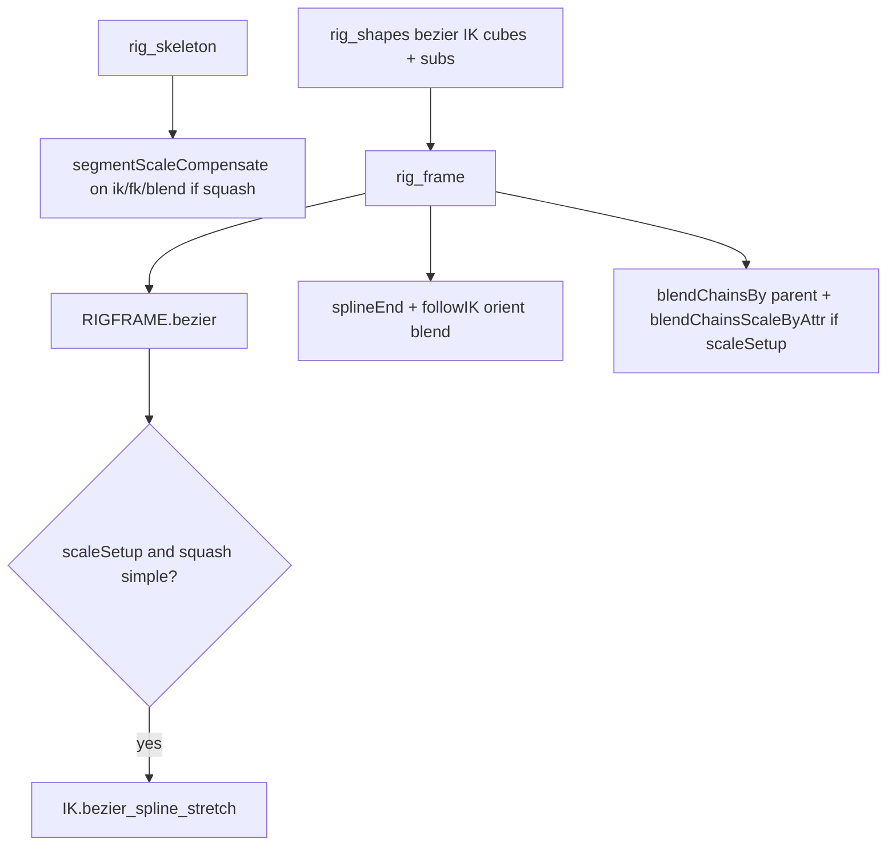

# Feature: Bezier IK (MRS Segment)

## Status and Overview

- **Status**: In progress — **Maya-verified** for Segment `ikSetup=bezier`, `segmentType=parent`, `scaleSetup` + squash **simple**, `segmentStretchBy` **translate** and **scale**; Segment **`segmentType=bezier`** in py3 (bezier CV **handle** shapes + `controlsSegmentBezier`; segment ribbon + **`rig_frame`** like ribbon — **not** coupled to `ikSetup=bezier`)
- **Last Updated**: October 22, 2026 — Segment **`rig_inflate`** contract (ribbon / parent spline·curve / bezier); **`volumeSquashInflateOnly`** on **`bezier_spline_stretch`** for parent **`ikSetup=spline`**
- **Audience**: Dev / TA — design contract for Bezier spline IK on MRS Segment (not artist manual prose)
- **Branch timeline**: [`Branches/Branch_BezierIK.md`](../Branches/Branch_BezierIK.md)

**Maintenance rule**: Update when changing `IK.bezier_spline`, `IK.bezier_spline_stretch` (incl. **`volumeSquashInflateOnly`**), `IK.ribbon` skin-tighten / squash share paths, `bezier_utils`, `rigFrame_utils.bezier` / **`rigFrame_utils.spline`** (driver curve return), **`segment_mid`**, `bezier_ik_block_utils.py` (incl. **`segment_inflate_stretch_result_from_volume_joints`**, **`rig_inflate`** helpers), `dynamic_utils._apply_hair_spline_ik_advanced_twist`, `skin_utils.surface_tightenEnds` / `curve_tightenEnds`, or Segment / Head neck / Limb bezier squash-stretch paths (`segment.py`, `head.py`, `limb.py`).

**Related**

- [`Feature_MRSWiring.md`](Feature_MRSWiring.md) — rigNull messages, control caches
- [`Builder.py`](../../cgmToolsPy3/cgm/core/mrs/Builder.py) — MRS Builder **Step Build** (`ui_stepBuild`)
- [`ik_utils.py`](../../cgmToolsPy3/cgm/core/rig/ik_utils.py), [`bezier_utils.py`](../../cgmToolsPy3/cgm/core/rig/bezier_utils.py), [`rigFrame_utils.py`](../../cgmToolsPy3/cgm/core/mrs/lib/rigFrame_utils.py), [`bezier_ik_block_utils.py`](../../cgmToolsPy3/cgm/core/mrs/lib/bezier_ik_block_utils.py), [`segment.py`](../../cgmToolsPy3/cgm/core/mrs/blocks/organic/segment.py), [`head.py`](../../cgmToolsPy3/cgm/core/mrs/blocks/organic/head.py)

---

## Scope (current)

### In scope (shipped / verified)

| Block config | Behavior |
|--------------|----------|
| `ikSetup` **bezier** | `RIGFRAME.bezier` → `IK.bezier_spline` + CV control wire + **`bezier_ik_connect_spline_advanced_twist`** (Object Rotation Up Start/End; optional **`ikSplineTwistUpStart`** / **`ikSplineTwistUpEnd`** on Segment + Head) |
| `segmentType` **parent** | Precheck enforces; ribbon-style segment joints optional per parent path |
| `scaleSetup` on | FK/IK → blend: **parent** `blendChainsBy` + **`blendChainsScaleByAttr`** (not scaleConstraint) |
| `squash` **simple** + `scaleSetup` | `IK.bezier_spline_stretch` on IK chain (`ml_ikUse` with spline end joint) |
| `segmentStretchBy` | **translate** or **scale** — passed to `bezier_spline_stretch` |
| `squashMeasure` (block / `d_squashStretch`) | **arcLength** (default, production) — global driver `curveInfo` ratio. **pointDist** — *(experimental)* per-segment `distanceDim` on driver **POCI** positions (bind U; scale stretch). Translate stretch may track joint U via **nearestPointOnCurve** → POCI `parameter`. **Maya-verified:** `globalScalePlug` → driver `masterScale` normalizes **live** segment distance only (`distance / masterScale / bindSegDist`); bind rest is **not** divided by `masterScale` (matches arcLength + ribbon pointDist). |
| Head **`neckIK`** **bezier** + **`segmentType`** **parent** + **`neckControls` > 1** (split **`headIK`** / neck-end **`controlIK`**) | **`ml_ikUse`**: neck chain + **`_splineEnd`** dup (parent **`ml_ikJoints[-2]`**). **`ml_ikJoints[-1]`** (`head_*_ik_sknJnt`) **only** **`p_parent = headIK`** — no **`pointConstraint`**, **`_splineControl`**, or **`followIK`** on the head IK joint. Ribbon end **`ribbonIKDrivers[-1]`** → neck-end **`controlIK`**. Twist end: **`mTwistEndControl=headIK`** in **`RIGFRAME.bezier`** (`twistEndAdd` on **`headIK`**). Advanced twist WU: **`ikSplineTwistUpStart`** / **`ikSplineTwistUpEnd`**. Stretch/squash/inflate on **`ml_ikUse`**. **`int_handleEndIdx = -2`**. With **`scaleSetup`**, no **`scaleConstraint(headIK → ml_ikJoints[-1])`** when split (scale from parenting). |

### Out of scope (this feature doc)

- Sine / wave driver stack on hidden POCI curve (**tabled** on [`Branch_BezierIK.md`](../Branches/Branch_BezierIK.md))
- `segmentType` ribbon / spline / curve / linear with `ikSetup` bezier (precheck blocks)
- **Limb** `segmentType=bezier` — roll-section stretch in progress (see § Limb bezier segments); shapes/controls parity still paired with user

### Roadmap — Segment build combinations

| Config | Status |
|--------|--------|
| `ikSetup=bezier`, `segmentType=parent`, no `scaleSetup` | Shipped |
| Same + `scaleSetup` + `squash=simple` + `segmentStretchBy` translate or scale | Maya-verified |
| `segmentType=bezier`, any supported `ikSetup` except **bezier** | Shipped (py3) — **`segment_rig_segments_bezier`** on **segmentJoints** (rig guts: `bezierIKCurve` / `bezierIKDriverCurve`); bezier CV **handleJoints**; `RIGFRAME.segment_handles` + module **`ikSetup`** on IK chain |
| `segmentType=bezier` + `ikSetup=bezier` | **Not supported yet** (precheck) — dual-bezier deferred |
| Sine / wave on driver | Tabled (lib only in `ik_utils`) |

---

## Artist / block toggles

| Attr | Effect |
|------|--------|
| `ikSetup` / Head `neckIK` = bezier | Bezier driver + ikSplineSolver chain |
| **`ikSplineBezierMode`** (Segment, Head, Limb — rig UI) | **`uniform`** (default) \| **`bend`** — passed to **`IK.bezier_spline`** as **`bezierAnchorMode`** via **`block_bezier_anchor_mode`**. Legacy block nodes may still have **`splineBezierMode`**; lib reads that name when **`ikSplineBezierMode`** is absent. |
| **`ikBezierControlShape`** (Segment, `ikSetup=bezier`) | **`ball`** (default) — FK cross-section **cube** mains + **sphere** subs (neck bezier). **`segmentHandle`** — cast-thin **cube** mains (**`jointRadius`** on aim, cross from proxy cast — limb bezier) + **`limbSegmentHandle`** semiSphere subs. Head/Limb unchanged (no attr → **`ball`**). **SemiSphere size** (all segment **`limbSegmentHandle`** casts, incl. **`RIGSHAPES.segment_handles`**) — **`builder_utils.segment_handle_cast_semisphere_size`**: mean **`moduleJoints`** adjacent span **÷ 4**, capped by **`jointRadius`**. |
| `segmentType` = **parent** | Bezier solve on **ik** chain; mains = `controlIKBase` / mids / `controlIK` |
| `segmentType` = **bezier** | Bezier CV mains/subs on **handleJoints** (`controlsSegmentBezier`); segment deformation follows ribbon path; handles ride **`rig_frame`** like ribbon. **`ikSetup`** independent (**`ikSetup=bezier`** combo not supported yet). |
| `scaleSetup` | Enables scale blend to **blend** joints; bezier does **not** use ribbon IK scaleConstraints on IK (stretch owns IK channels) |
| `squash` = simple | With `scaleSetup`, runs `bezier_spline_stretch` after IK + end follow blend |
| `segmentStretchBy` | `translate` — segment length via joint **translate**; volume squash = linear **1/ratio** on clamped arc ratio. `scale` — aim-axis **scale**; volume = **ratio^-0.5** |
| Settings **`stretch`** | Curve-follow weight on settings (from `bezier_spline_stretch`). **`0`** = rest bind for the curve term; **`1`** = full arc-length match. Does **not** change length when arc ratio **`r`** stays **1**. |
| Settings **`lengthScale`** | Uniform length multiplier on settings (default **1**, min **0.0001**). **`finalRatio = curveBlend × lengthScale`**. Key this when **`r ≈ 1`** (bind match or static curve). No block mirror attr in v1 — settings only. |
| Settings **`squash`** | Volume compensation strength on perpendicular scales (see volume driver below). **`bezier_spline_stretch`** creates it with default **1.0** (Maya default + current value). **Volume squash** paths (block **`squash`** **simple** / **both**) keep **1.0** after build. **`squash:none`** stretch-only (no volume on joints) pins **`squash`** to **0** on settings so the attr is inert. |
| `squashExtraControl` | Enables per-joint volume **`{base}_outFactor_i`** on settings (`extraSquashControl` in lib). Requires volume squash active on the block path (limb: `_limb_bezier_volume_squash_active`). |
| `squashInflateControl` | Segment / Head / Limb. When **on**, `bezier_spline_stretch` gets **`extraInflateControl`** (settings **`squashInflate`** / **`squashInflateOffset`**, **`{part}_inflateFactor_i`**). Independent of **`squashExtraControl`**. Legacy blocks without the attr fall back to **`squashExtraControl`**. Default **on**. |
| **`squashInflateFactorMin` / `Max` / `Mode`** (block Squash/Stretch UI) | Ramp for **settings** `{partName}_inflate_inflateFactor_i` defaults — **not** **`squashFactorMin/Max`** (those drive volume **`outFactor_*`** only). **`squashInflateFactorMode`**: same enum set as **`squashFactorMode`** (`midPeak`, **`midBulge`**, …). **`squashInflateFactorMin` may be negative** for contract vs inflate. Legacy block attrs **`inflateFactorMin/Max/Mode`** still read via **`block_squash_inflate_factor_min_max`** / **`block_squash_inflate_factor_mode`**. |
| Settings **`squashInflate`** | Additive strength on the inflate ramp (default **0**). Raise **> 0** to inflate; negative **`inflateFactor_*`** on a joint contracts when this is **> 0**. |
| Settings **`squashInflateOffset`** | ±2 slides the inflate ramp along the chain (`shift = offset × maxIdx/2`; sample index `s = g − shift` with lerp between adjacent factor indices). Limb: **`g`** is global across roll sections (`inflateSlideGlobalCount` / `Start`). |
| End IK `followIK` | Default **0** on **Segment** bezier (orient blend via **`_splineControl`** on end IK joint). **Head** split path (**`headIK` ≠ `controlIK`**): **no** end follow blend on **`ml_ikJoints[-1]`** — head joint follows **`headIK`** only. |
| **`ikSplineTwistUpStart`** / **`ikSplineTwistUpEnd`** | Segment + Head only (`BLOCKSHARE._d_attrsTo_make['shapeDirection']`). **`dWorldUpVector`** / **`dWorldUpVectorEnd`** on bezier ikSpline handle (defaults **y+** start; end **y+** on Segment, **z-** on Head). **`bezier_ik_block_twist_world_up_vectors`** → **`RIGDYN._apply_hair_spline_ik_advanced_twist`**. Limb roll bezier unchanged (orientation up vector only). |
| Head **`ikMidAimSetup`** | **Head block only** (default **off**). With **`ikMidSetup=linearTrack`** and aim **on**: **`{part}_midRootEnd_aimRef`** parented under **`controlIKBase`**; **`aimConstraint`** base → end IK; each mid **`mainDriver`** **`orientConstraint`** to ref (not driver-to-driver aim). **`cubicTrack`** / Segment (no attr) keep legacy driver-chain aim when aim is on. |

---

## Prechecks and Step Build

Rig validation lives in block **`rig_prechecks`** (via `rigFactory.prechecks`). Relevant bezier rules today:

| Check | Message (typical) |
|-------|-------------------|
| `ikSetup` bezier + `segmentType` ≠ `parent` | `ikSetup bezier requires segmentType parent` |
| `segmentType` bezier + `ikSetup` = bezier | `segmentType bezier with ikSetup bezier is not supported yet` |
| `segmentType` bezier + `numControls` < 2 | `segmentType bezier requires at least 2 controls` |
| Head `neckIK` bezier + `segmentType` ≠ parent | `neckIK bezier (phase 1) requires segmentType parent` |
| `segmentType` parent + `numControls` ≠ `numJoints` | `segmentType parent requires same number of controls as joints` |
| Head parent + `neckControls` ≠ `neckJoints` | `segmentType parent requires same number of controls as joints` |

**How to run prechecks**

| Entry | Behavior |
|-------|----------|
| **Rig → Prechecks** (MRS Builder block menu) | `mBlock.asRigFactory(mode='prechecks')` — PASS/FAIL banner + numbered lines in Script Editor; no rig build |
| **Rig → Step Build** | Same precheck pass **before** `rigFactory` full init; on fail, stepped UI shows **Precheck errors** (indexed list) and **no** rig step buttons — does not raise through `GuiFactory` |

Block must be **skeleton** state for Step Build layout (unchanged). Fix attrs on the block, then reopen Step Build or refresh the tool after reloading `Builder.py`.

**Maintenance**: If `rig_prechecks` messages or factory precheck contract change, update this table and [`Branches/Branch_BezierIK.md`](../Branches/Branch_BezierIK.md).

---

## Lib API

### `IK.bezier_spline`

Hidden POCI **driver** curve + visible **bezierIKCurve** + ikSpline IK handle. Returns dict (`mDriverCurve`, `mBezierCurve`, `mIKHandle`, `ml_joints`, twist plugs, …).

**Block anchor mode:** **`RIGFRAME.bezier`** and **`segment_rig_segments_bezier`** pass **`bezierAnchorMode=block_bezier_anchor_mode(mBlock)`** — from block enum **`ikSplineBezierMode`** (`uniform` \| `bend`).

### `IK.bezier_spline_stretch`

Arc-length stretch from **driver curve** (`bezierIKDriverCurve` on rigNull — POCI driver, not CV rig curve).

**Note:** Block **`squashMeasure` → `pointDist`** (per-segment driver distances) is **experimental** for bezier scale/stretch; default **`arcLength`** for production. Segment **Step Build → prechecks** emits a warning when `pointDist` is selected.

- **`r`** = `arcRatio` (global **arcLength**) or per-segment **`segRatio`** (**pointDist**): live measure ÷ joint rest (with existing **`masterScale`** rules).
- **`curveBlend = 1 + stretch * (r - 1)`** — unchanged **`stretch`** semantics.
- **`finalRatio = curveBlend * lengthScale`** — both attrs on **settings**; **`lengthScale`** default **1**.
- **translate**: per-segment `translate` on aim axis × `finalRatio`; secondary scales via squash blend
- **scale**: aim-axis scale × `finalRatio`
- Volume driver: see `_bezier_stretch_volume_driver` in `ik_utils` (uses **`finalRatio`**, not curve blend alone)
- **DG helpers** (`ik_utils`): **`_bezier_stretch_curve_blend_network`**, **`_bezier_stretch_apply_length_scale`**; global multiply node **`{base}_stretch_lengthScale_md`**; pointDist per segment **`{base}_stretch_seg_##_lengthScale_md`**. Return dict adds **`mPlug_lengthScale`**, **`mLengthScaleMd`** (arc path).
- **Rebuild**: existing rigs need **`rig_frame`** / limb **`rig_segments`** re-run to create **`lengthScale`** + multiply nodes (not attr-only).
- **`globalScalePlug`**: Segment passes **`get_blockScale` / `segMeasure`** master scale (`mPlug_masterScale`) — wired to driver **`masterScale`**. **arcLength** and **pointDist** both use **live measure / masterScale** over **bind rest** (pointDist: per-segment `distance / masterScale / bindSegDist`; do not divide bind rest by masterScale or global scale double-applies on volume squash).
- **`volumeSquashInflateOnly`**: When **True**, builds arc-length **volume squash** + optional **inflate** (`inflateDriveDirectParents`) on joint **secondary scales only** — does **not** connect translate / aim-axis stretch (spline IK keeps length channels). Segment parent **`ikSetup=spline`** uses this in **`rig_inflate`** with the skinned spline driver curve from **`RIGFRAME.spline`** (`mSplineDriverCurve` on the block instance).

#### Volume squash vs inflate (`squashExtraControl`)

| Layer | Settings attrs | Math (per squash joint) |
|-------|----------------|---------------------------|
| Volume | `{base}_outFactor_i` | `1 + (volBase − 1) × outFactor × squash` — **N−1** factors for **N** IK joints (per stretch span; tip has no `outFactor`). |
| Inflate | `{part}_inflateFactor_i`, `squashInflate`, `squashInflateOffset` | `volScale + factorSample × squashInflate` (`inflateAdd_*` mult + PMA). Ramp attrs **`inflateFactor_0 … inflateFactor_{N−1}`** for **N** joints (whole chain). **Direct-parent inflate** (`inflateScale` null): span joints use per-`outFactor` volume; **tip** uses global/last-span volume squash + last ramp slot (no `outFactor` attr). Settings factor attrs use block **`squashInflateFactorMin/Max`**; **`squashInflateFactorMin` may be negative** so some joints contract while others inflate. **`squash`**, **`squashInflate`**, **`squashInflateOffset`** are keyable; per-joint **`inflateFactor_*`**, **`outFactor_*`**, and ribbon **`aimFactor_*`** are **not keyable** but stay **visible** in the channel box / attribute editor. |

**Lib kwargs** (Segment + Head + Limb callers): `extraSquashControl`, `extraInflateControl` (inflate attrs can build when `squashExtraControl` is on even if volume squash is off on a given code path — **wiring** still requires the volume per-joint squash network today: `ml_inflate_pending` is populated only inside `extraSquashControl` stretch branches). `inflateFactorBaseName`, `inflateSlideGlobalCount`, `inflateSlideGlobalStart`, `inflateFactorMin/Max/Mode` (block **`squashInflateFactorMode`** → **`inflateFactorMode`** kwarg). **`inflateDriveDirectParents`**: IK joints get **volume squash only**; full inflate scale plugs are returned in **`l_inflateDirectPlugs`** for block wiring.

**FK + direct controls** (`squashInflateControl` on): inflate must not ride **`blendChainsScaleByAttr`** alone (FKIK=0 drops IK inflate). **`segment_inflate_parent_rig_direct_controls`** (wraps legacy **`bezier_inflate_parent_segment_direct_controls`**) wires visible **`{rigJoint}_inflateScale`** nulls; **`masterGroup`** (or rig joint) parents under each null.

#### Segment inflate build order (`segment.py`)

Segment **`__l_rigBuildOrder__`** runs **`rig_inflate`** **after** **`rig_segments`** and **before** **`rig_cleanUp`** (deform squash must exist on joints before overlay; direct **`masterGroup`** exists from **`rig_controls`**).

| Step | Inflate responsibility |
|------|-------------------------|
| **`rig_segments`** | **`IK.ribbon`** / curve / spline segment deform only — **no** inflate parent wire on ribbon segment types. **`segmentType=bezier`**: full **`bezier_spline_stretch`** on seg chain → store **`self.d_segmentBezierStretch`**. |
| **`rig_frame`** | **`ikSetup=bezier`** + parent **`segmentType`**: full **`bezier_spline_stretch`** on IK use chain → **`self.d_stretchInflateRes`**. Spline IK: stash **`self.mSplineDriverCurve`** for **`rig_inflate`**. **Do not** parent **`inflateScale`** nulls here for segment overlay types. |
| **`rig_inflate`** | **`squashInflateControl`** + overlay **`segmentType`**: build stretch result (if needed), then **one** **`segment_inflate_parent_rig_direct_controls`** pass. |

| Block / path | When | How inflate is built | Parent anchor |
|--------------|------|----------------------|----------------|
| **Segment** parent + **`ikSetup=bezier`** | **`scaleSetup`**, squash, **`squashInflateControl`** | **`rig_frame`** → **`bezier_spline_stretch`**; **`rig_inflate`** → parent wire from **`d_stretchInflateRes`** | **`blendJoints[i]`** |
| **Segment** **`segmentType=bezier`** | squash + inflate on seg stretch | **`rig_segments`** → **`bezier_spline_stretch`**; **`rig_inflate`** → parent from **`d_segmentBezierStretch`** | **`segmentJoints[i]`** |
| **Segment** **`segmentType=ribbon` / `ribbonLive`** | squash on seg ribbon + **`squashInflateControl`** | **`rig_inflate`** → **`segment_inflate_stretch_result_from_volume_joints`** on **`segmentJoints`** with **`leave_joint_volume_wiring=True`** (read ribbon volume drivers; **do not** reconnect seg joint scale) | **`segmentJoints[i]`**; directs parented under seg joints in **`rig_controls`** (same as **`segmentType=bezier`**) |
| **Segment** parent + **`ikSetup` spline** | **`scaleSetup`**, block **`squash`**, **`squashExtraControl`**, **`squashInflateControl`** | **`rig_frame`**: **`RIGFRAME.spline`** → stash **`self.mSplineDriverCurve`**. **`rig_inflate`**: **`bezier_spline_stretch`** with **`volumeSquashInflateOnly=True`**, **`inflateDriveDirectParents=True`**, driver = spline curve, joints = **`ikJoints`**; then **`segment_inflate_parent_rig_direct_controls`** on **`blendJoints`**. Spline IK length/stretch unchanged. | **`blendJoints[i]`** |
| **Segment** parent + **`ikSetup` curve** | **`scaleSetup`**, **`b_squashSetup`** (ribbon squash on **`ikJoints`** in **`rig_frame`**) | **`rig_inflate`**: **`segment_inflate_stretch_result_from_volume_joints`** on **`ikJoints`** (reads existing volume drivers; reconnects IK to volume-only when not ribbon seg). | **`blendJoints[i]`** |
| **Head** | `neckIK=bezier`, `segmentType=parent` | Same contract as Segment parent bezier — **`head.py` `rig_frame`** + inflate parent (Head may still inline parent until aligned with **`rig_inflate`**) | **`blendJoints[i]`** |
| **Limb** | `segmentType=bezier`, `scaleSetup` | Per-section **`bezier_spline_stretch`** in **`rig_segments`**; inflate parent at end of **`rig_segments`** (limb timing unchanged) | **`segJoints_{section}[i]`** |

**Settings attrs** (`squashInflate`, **`squashInflateOffset`**, **`{part}_inflate_inflateFactor_*`**) are created when the inflate **DAG** build runs ( **`bezier_spline_stretch`** with **`extraInflateControl`**, or **`segment_inflate_stretch_result_from_volume_joints`** after volume drivers exist). **`{rig}_inflateScale`** nulls and **`masterGroup`** reparent happen only when **`l_inflateDirectPlugs`** is non-empty and **`segment_inflate_parent_rig_direct_controls`** runs.

#### Parent `ikSetup=spline` — inflate vs `{rig}_inflateScale` (troubleshooting)

| Symptom | Likely cause | Fix |
|---------|----------------|-----|
| Settings **`squashInflate`** / **`inflateFactor_*`** exist, **no** **`{rig}_inflateScale`** nulls | **`rig_inflate`** skipped parent wire (`skip parent wire` log) — no **`l_inflateDirectPlugs`** | Full module rebuild through **`rig_inflate`** (not attr-only refresh). Check Script Editor. |
| **`skip parent wire \| segmentType:parent ikSetup:spline`** | Missing **`mSplineDriverCurve`** ( **`rig_frame`** did not return curve), or **`squashExtraControl`** off, or **`scaleSetup`** off | **`scaleSetup`**, **`squashExtraControl`**, **`squashInflateControl`** on; block **`squash`** not **none**; rebuild **`rig_frame`** then **`rig_inflate`**. |
| No **`spline volume squash + inflate`** log | **`squashInflateControl`** off, or **`segmentType`** not in overlay set (**`parent`**, **`ribbon`**, **`ribbonLive`**, **`spline`**, **`curve`**) | Enable **`squashInflateControl`**; parent **`segmentType`** for standard FK/IK → blend modules. |
| Inflate attrs on, ribbon seg path | **`segment_inflate_stretch_result_from_volume_joints`** created settings then found **no** volume on **`segmentJoints`** | Rebuild **`rig_segments`** first; ribbon squash must drive seg joint **`scaleX`/`scaleY`** (or aim-axis volume attrs) before **`rig_inflate`**. |

**Success logs (Script Editor):** `rig_inflate` → `spline volume squash + inflate | driver:<splineCurve>` → `inflate direct parents | ikSetup:spline segmentType:parent | plugs:N` (expect **N** = joint count for inflate ramp, incl. tip — see § volume vs inflate counts).

#### What NOT to do (Segment ribbon / ribbonLive inflate)

| Do not | Why |
|--------|-----|
| Call **`IK.bezier_spline_stretch`** with **`volumeSquashInflateOnly=True`** + **`replaceExisting=True`** on **`segmentJoints`** after **`IK.ribbon`** | Disconnects ribbon volume scale wiring and rebuilds squash from the measure curve — **breaks base segment squash/stretch**. |
| Run inflate overlay in **`rig_frame`** before **`rig_segments`** | Segment ribbon squash does not exist yet; volume driver read fails or targets wrong joints. |
| Pass **`extraInflateControl`** / inflate ramp kwargs through **`squash_stretch_ik_share_kwargs`** into **`IK.ribbon`** | **`shared_dat`** strips those keys on purpose; ribbon IK does not own inflate settings. |
| **`_bezier_stretch_connect_inflate_joint_or_direct`** on ribbon **`segmentJoints`** when **`leave_joint_volume_wiring=True`** is required | Reconnects joints to “volume-only” plugs and fights ribbon **`scaleX`/`scaleY`** (or MD) squash. Inflate belongs on **`{rig}_inflateScale`** above directs only. |
| Add ad-hoc DG (**`floatConstant`**, fake unity volume nodes, factor-only networks without reading existing volume) for ribbon | Use **`segment_inflate_stretch_result_from_volume_joints`** sampling **existing** drivers, or full **`bezier_spline_stretch`** only on chains **you** own (parent IK bezier, **`segmentType=bezier`** seg solve). |
| Create settings inflate attrs in a separate “ensure” path when stretch did not build | If inflate built correctly, settings attrs are already there; fix the stretch/overlay path instead. |

Rebuild module after py3 edits.

#### `IK.ribbon` skin weight tighten (Python 3)

Shared legacy path for **`ikSetup=ribbon`** / **`ribbonLive`** in **`segment.rig_frame`**, **`segmentType=ribbon` / `ribbonLive`** in **`rig_segments`**, and other callers — **not** Bezier-spline-specific, but often hit while rebuilding Segment with squash on after inflate/ribbon work.

| Symptom | `TypeError: slice indices must be integers…` in **`RIGSKIN.surface_tightenEnds`** at `l_cvsUse[:blendLength]` |
|---------|------------------------------------------------------------------------------------------------------------------|
| Cause | **`blendLength = int_lenJoints / 2`** is a **float** in py3. When **`extendEnds`** is on (block default **`ribbonExtendEnds=True`**) or **`int_lenInfluences > 2`**, **`IK.ribbon`** sets **`mode_tighten=None`**, so **`surface_tightenEnds`** does **not** run the **`twoBlend`** branch that recomputes integer **`blendLength`**. |
| Typical block setup | **`ikSetup=ribbon`**, **no** mid IK (only start/end **`ribbonIKDrivers`** → **`int_lenInfluences == 2`**), squash on ( **`get_blendList`** log before skinning is normal). |
| Fix (py3) | **`ik_utils`**: **`blendLength = int_lenJoints // 2`** (both ribbon skin blocks). **`skin_utils`**: **`blendLength = int(blendLength)`** after **`twoBlend`** reassignment in **`surface_tightenEnds`** and **`curve_tightenEnds`**. |

Reload **`ik_utils`** / **`skin_utils`** (module rebuild or core reload) after py3 sync.

**Inflate factor sampling** (`_bezier_stretch_inflate_offset_sample_network`): clamped `s` → floor index + fractional lerp via **choice** + **blendTwoAttr**; floor from a hidden **`floorUtil`** transform + expression (`floor(sampleS)`). DG nodes are created with **`_bezier_stretch_dg_named_node`** (`cgmMeta.cgmNode(mc.createNode(type))` then `rename`) — do not use `cgmNode(nodeType='floatMath')` (invalid / wrong node type in scene). All `{part}_inflateFactor_0..maxIdx` attrs are ensured on settings before sampling (`_bezier_stretch_inflate_factor_plugs_ensure`); **maxIdx = joint count − 1** (not `outFactor` span count − 1).

**Rebuild**: Changing inflate DAG requires re-running **`bezier_spline_stretch`** (module segment/limb build), not attr-only refresh. Reload **`ik_utils`** after py3 edits.

#### Stretch verification (Maya)

| Case | Expect |
|------|--------|
| Bind **`r=1`**, **`stretch=1`**, **`lengthScale`** 0.5 → 2 | Chain length scales; **`stretch`** alone unchanged vs pre-**`lengthScale`** rigs |
| **`r=1.2`**, **`stretch=1`**, **`lengthScale=1`** | **`finalRatio=1.2`** (same as before **`lengthScale`**) |
| **`r=1.2`**, **`stretch=0.5`**, **`lengthScale=1`** | **`finalRatio = 1 + 0.5×0.2 = 1.1`** |
| **`stretch=0`**, **`lengthScale=2`** | **`finalRatio=2`** (rest × 2) |

### `RIGBEZIER.bezier_controls_wire_from_handles`

Index-aligned main IK cubes + tangent sub spheres; subs parent to main handle (not main `masterGroup`).

### `RIGCONSTRAINT.blendChainsScaleByAttr`

Per-joint `blendTwoAttr` on `scaleX/Y/Z`: FK = `input[0]`, IK = `input[1]`, driver = **FKIK** (0 FK, 1 IK). Used for Segment scale setup instead of scaleConstraint FK/IK → blend.

### `bezier_ik_connect_spline_advanced_twist` (`bezier_ik_block_utils`)

After driver **`twistStart`/`twistEnd`** wiring in **`RIGFRAME.bezier`**: enables spline IK advanced twist, sets **`dForwardAxis`** / **`dWorldUpAxis`** from module orientation, **`dWorldUpMatrix`** / **`dWorldUpMatrixEnd`** from base + end IK controls. Optional per-block **`ikSplineTwistUpStart`** / **`ikSplineTwistUpEnd`** override **`dWorldUpVector`** / **`dWorldUpVectorEnd`**. Limb roll sections use the same helper with **`wire_driver_twist_from_mains=True`** (direct driver twist from section mains).

### `RIGFRAME.segment_mid` (Head mid IK aim)

**`linearTrack`**: mid controls ride **`mainDriver`** + **`attach_toShape`**. Head + **`ikMidAimSetup`**: shared root→end orientation via **`midRootEnd_aimRef`** under start IK (**`mIKBase`**), **`orientConstraint`** onto each **`mainDriver`**.

---

## MRS build flow (Segment)

### rigNull messages (bezier)

| Message / msgList | Content |
|-------------------|---------|
| `bezierIKDriverCurve` | Hidden driver for stretch `curveInfo` (child of rigNull from `rigFrame_utils.bezier`) |
| `bezierIKSubControls` | Tangent sub control joints |
| `bezierIKTrackCurves` | Linear track curves (aux); `overrideVisibility` → settings `result_IKon` (FK/IK vis) |
| `bezierIKSubsBase`, `bezierIKSubsMidN`, `bezierIKSubsEnd` | Subs per main IK slot |

Session build buffers on block instance: `md_bezierIKSubsBySlot`, `ml_bezierIKSubControls`, `ml_bezierIKTrackCurves` — reinit after `MODULECONTROL.register` (`_bezier_ik_reinit_session_meta`).

**Pickwalk / ordered IK DAG lists:** At **`rig_controls`**, each main IK DAG gets a **`bezierIKSubs`** msgList (ordered sub **transforms** only). **Segment (`ikSetup=bezier`, `segmentType=parent`):** **`controlsIK`** = full bezier chain. **Segment (`segmentType=bezier`):** **`controlsSegmentBezier`** = handle CV pickwalk; **`controlsIK`** = module base/end IK. **Head (`neckIK=bezier`):** primary **`controlsIK`** = neck root + **`headIK`**; neck CV chain on **`controlsNeckBezier`** via **`bezier_ik_rig_controls_build_controls_ik(..., str_aggregate_msglist=controlsNeckBezier)`**. **Limb (`segmentType=bezier`):** foot/hand IK plugs first in **`d_controlDat_links['ik']`**, then **`controlsSegmentBezier`**. Flat **`bezierIKSubControls`** is auxiliary. **`bezier_ik_ensure_aggregate_ik_msglist`** repairs aggregate lists at verify. Registered anim controls use **`controlAnim`** + **`ikBezier`** / **`ikBezierSub`** modifiers. Track curves stay on **`bezierIKTrackCurves`** only.

### Squash skeleton invariant

When `b_squashSetup` and IK on: **`rig_skeleton`** calls `_squash_ik_fk_blend_segment_scale_compensate` — **`segmentScaleCompensate = True`** on **ik**, **fk**, and **blend** chains (not segment measure joints).

### Aim axis for stretch

`_bezier_ik_stretch_aim_axis` uses `d_orientation['stringAim']`, not rotate-order string alone.

### Limb bezier segments

**`limb.py`**: `segmentType=bezier` per roll section — `_limb_rig_segments_bezier_squash_stretch` → `IK.bezier_spline_stretch` on section IK chain with shared settings, `inflateFactorBaseName='{partName}_inflate'`, and `_limb_bezier_inflate_slide_global_spec` for cross-section inflate indices. Same stretch/squash/inflate contract as Segment; volume squash gated by `_limb_bezier_volume_squash_active`.

**Interior seg aim world-up (Limb only):** `_limb_bezier_seg_handle_reg_curve` / `_limb_rig_segments_bezier_section_seg_aims` set forward/back **aimConstraint** `worldUpObject` to the roll section **start main** (`ml_mains[0]` / `handleJoints[section_idx]` ikBezier anim). **stableEnd** / **stable** follow blends and `curveSeg_{section}` networks are unchanged.

**End segment main stable / followRoot (Limb only, all profiles):** `_limb_rig_segments_bezier_end_main_follow_root` runs on the roll section whose end main is the **last rig `handleJoints`** entry (culled IK span — wrist, ankle, etc.; not prerig `int_handleEndIdx`). Applies **followRoot** + **stableEnd**. Not gated on `addBall` / `addLeverEnd` (parity with ribbon last segmentHandle). Back aimer aim world-up uses section **start main** (`handleJoints[section_idx]`). Rebuild **`rig_segments`** to refresh constraints.

### Head neck bezier (not Segment parity for controls)

**`head.py`** with **`neckIK=bezier`**, **`segmentType=parent`**, **`neckControls > 1`**:

| rigNull / control | Role |
|-----------------|------|
| **`headIK`** | Main head anim IK — **end of primary IK pickwalk** (`controlsIK`: neck root + **`headIK`**). |
| **`controlIK`** / **`controlIKBase`** / mids / subs | Neck **bezier** system only — ordered on **`controlsNeckBezier`** (not replacing foot/head primary IK). |
| **`controlsNeckBezier`** | Full neck bezier pickwalk (base → … → neck-end **`controlIK`** + subs). Walk **after** **`controlsIK`** in `d_controlDat_links['ik']`. |

**`rig_frame` (split head path, `neckControls > 1`):** Ribbon end **`ribbonIKDrivers[-1]`** → neck-end **`controlIK`** (not **`headIK`**). **`RIGFRAME.bezier`** on **`ml_ikUse`** (last entry = **`_splineEnd`** dup of head IK joint, parented under **`ml_ikJoints[-2]`**). **`ml_ikJoints[-1]`** is parented under **`headIK`** only — **not** under neck-end **`controlIK`**, and **without** the Segment-style **`pointConstraint` + `followIK` + `_splineControl`** stack on the head IK joint. **`mTwistEndControl=headIK`** for driver twist / advanced twist world-up end. **`rig_controls`**: neck-end **`controlIK`** **`get_switchTarget`** → **`headIK`**; **`int_handleEndIdx = -2`** sizes end bezier cube from last neck FK. **`rig_cleanUp`**: neck-end **`controlIK`** dyn parents include **`headIK`**; separate **`headIK`** dyn parent pass when **`headIK` ≠ `controlIK`**. No **`parentConstraint`** from **`headIK`** onto neck-end **`controlIK`**. Legacy single-control neck (**`headIK` == `controlIK`**) keeps Segment-like end follow on **`ml_ikJoints[-1]`**.

**`rig_cleanUp`:** When **`headIK`** ≠ **`controlIK`**, **`headIK`** gets its own **`cgmDynParentGroup`** rebuild (same parent list as neck **`controlIK`** / **`controlIKBase`**: attach/world/end pivots, **`controlIKNeckRoot`**, parent module IK/root, **`mRoot`** when present). Not **`blendHead`** — that alias is for **look-at** dyn parents on the neck blend joint, not the head anim IK.

Legacy neck modes (spline / ribbon / single **`controlIK`** on head) keep one transform for **`headIK`** + **`controlIK`**.

**Mid IK (`ikMidSetup`) on Head:** **`ikMidAimSetup`** exists only on **`head.py`** (not Segment). Ribbon / spline neck paths use existing handle aim; bezier + **`linearTrack`** + aim on uses root→end ref (above). Do not use **`handle_fixTwist`** on bezier ikSpline handles (rp-only).

---

## Reload / test

| Change | Maya |
|--------|------|
| `ik_utils`, `bezier_utils`, `constraint_utils`, `rigFrame_utils`, segment build funcs (no `mClass`) | Rebuild segment or module **Reload Dependencies** on MRS tool if applicable |
| `mClass` / meta registry | `import cgm.core as CGM; CGM._reload()` then rebuild |

---

## Revision history

| Date | Summary |
|------|---------|
| 2026-10-22 | Block attr **`ikSplineBezierMode`** (was **`splineBezierMode`**) on Segment / Head / Limb + **`shared_dat`**; **`block_bezier_anchor_mode`** legacy read. Settings **`squash`** default **1.0** on volume squash (**`bezier_spline_stretch`** + segment/limb post-build); **0** when volume squash off |
| 2026-10-22 | **`IK.ribbon`** py3: integer **`blendLength`** for skin **`surface_tightenEnds`** (`// 2` in **`ik_utils`**, **`int()`** guard in **`skin_utils`**) — fixes ribbon **`rig_frame`** / segment ribbon build when **`extendEnds`** + two influences |
| 2026-10-21 | **Segment** `segmentType=bezier` + `ikSetup=bezier`: handle CV shapes/controls, `segment_rig_segments_bezier`, ikJoints follow seg; `controlsSegmentBezier` pickwalk |
| 2026-10-15 | **Head** neck bezier **`controlsIK`** pickwalk + **`controller_getDat`** / **`d_controlDat_links`**; **`controlSegMidIK`** msgList |
| 2026-10-15 | **Head** **`ikMidAimSetup`** + **`linearTrack`**: **`midRootEnd_aimRef`** under **`controlIKBase`**, **`orientConstraint`** on mid **`mainDriver`** (not handle-chain aim) |
| 2026-10-15 | **Segment** + **Head** **`ikSplineTwistUpStart`** / **`ikSplineTwistUpEnd`**; **`bezier_ik_connect_spline_advanced_twist`** + **`_apply_hair_spline_ik_advanced_twist`** (no **`handle_fixTwist`** on bezier) |
| 2026-10-15 | **Inflate**: negative **`inflateFactor_*`** / **`inflateFactorMin`** allowed — contract vs inflate via **`volScale + factor × squashInflate`** |
| 2026-10-15 | **pointDist** stretch: fix `_bezier_stretch_seg_final_ratio_network` — `masterScale` on live distance only (bind rest static); Maya-verified vs arcLength under puppet scale |
| 2026-10-19 | **Head** neck bezier (split): **`head_*_ik_sknJnt`** clean child of **`headIK`**; no end **`pointConstraint` / `followIK` / `_splineControl`** on head IK joint; **`ml_ikUse`** spline end under **`ml_ikJoints[-2]`**; skip **`scaleConstraint(headIK → last ik)`** when split |
| 2026-10-19 | **Head** neck-end **`controlIK`**: space / switch target + dyn parent **`headIK`** (not blend joint) |
| 2026-10-19 | Block **`squashInflateFactorMin/Max/Mode`** (Squash/Stretch UI; replaces **`inflateFactor*`** names) — ramp for settings **`{part}_inflate_inflateFactor_i`**, separate from **`squashFactorMin/Max`** |
| 2026-10-19 | **Head** + **Limb** bezier inflate: same **`inflateDriveDirectParents`** / direct-parent contract as Segment |
| 2026-10-19 | **`bezier_spline_stretch`**: settings **`lengthScale`**; **`finalRatio = curveBlend × lengthScale`**; shared curve-blend + length-scale DG helpers (arcLength + pointDist) |
| 2026-10-22 | **Parent `ikSetup=spline`**: **`rig_inflate`** + **`bezier_spline_stretch`** **`volumeSquashInflateOnly`** on **`ikJoints`** (driver **`mSplineDriverCurve`** from **`RIGFRAME.spline`**); **`{rig}_inflateScale`** on **`blendJoints`** like bezier |
| 2026-10-21 | **Segment `rig_inflate`** step after **`rig_segments`**; ribbon/ribbonLive overlay via **`segment_inflate_stretch_result_from_volume_joints`** + **`leave_joint_volume_wiring`**; **do not** second-pass **`bezier_spline_stretch`** on ribbon seg joints |
| 2026-10-19 | **Segment** bezier inflate: **`inflateDriveDirectParents`** + **`segment_inflate_parent_rig_direct_controls`** so FK sees inflate on direct-control parents (not FK/IK scale blend) |
| 2026-10-19 | **Head** neck bezier: drop **`headIK → controlIK`** parent constraint; ribbon end on neck-end **`controlIK`** |
| 2026-10-15 | **Head** **`rig_cleanUp`**: dyn parent rebuild on separate **`headIK`** (was only on **`ml_ikControls`** / **`controlIK`**) |
| 2026-10-15 | **Head** neck bezier: split **`headIK`** (anim) vs **`controlIK`** (neck-end ikBezier); ribbon end + constraint follow; stretch chain through neck + spline end |
| 2026-10-14 | `bezier_spline_stretch` additive inflate (`squashInflate`, separate inflate factor ramp, offset slide); limb + segment block attrs; DG named-node + floor util sampling (no `floatMath`) |
| 2026-10-13 | Docs: MRS build matrix (parent vs bezier `segmentType`); roadmap table in feature + branch |
| 2026-10-13 | Step Build: `ui_stepBuild` runs `mode='prechecks'` first; failures listed in window |
| 2026-10-13 | Segment parent bezier: stretch translate/scale, SSC at skeleton, `blendChainsScaleByAttr`, volume driver split for translate vs scale |
| 2026-10-12 | Initial feature stub; lib `bezier_spline` + CV rig (branch doc) |
